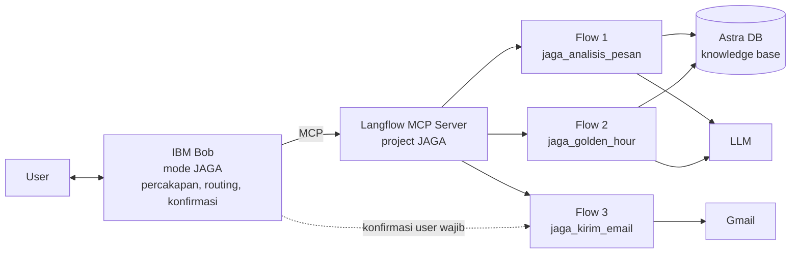

# JAGA - Asisten Tanggap Darurat Penipuan Digital

Hacktiv8 x IBM SkillsBuild National Hackathon 2026 | Tema: Financial
Dibangun dengan Langflow (eksekusi workflow) dan IBM Bob (antarmuka percakapan).

## 1. Ringkasan

JAGA membantu masyarakat, terutama orang tua dan pengguna yang kurang melek digital, dalam dua momen:
1. Sebelum tertipu: mengecek apakah sebuah pesan, link, atau file berisiko penipuan
2. Sesudah tertipu: memandu langkah darurat di "golden hour" dan menyiapkan kronologi laporan dalam hitungan menit

## 2. Masalah

- Sejak 22 November 2024 sampai 30 September 2026, Indonesia Anti-Scam Centre (IASC) menerima 702.342 laporan penipuan transaksi keuangan (Bisnis.com, 6 Oktober 2026)
- Total kerugian yang dilaporkan mencapai Rp9,1 triliun per 14 Januari 2026, sementara dana yang berhasil diblokir sekitar Rp436,88 miliar (Kontan, 22 Januari 2026)
- Sekitar 80% laporan baru disampaikan lebih dari 12 jam setelah kejadian, padahal dana penipuan bisa keluar dari rekening korban dalam kurang dari 1 jam (CNBC Indonesia, 21 Juni 2026)

Insight: celah terbesar ada di jeda antara kejadian dan tindakan. Korban panik, tidak tahu langkah pertama, dan tidak tahu harus melapor ke mana. Edukasi dan portal laporan yang ada mengandalkan korban yang tenang dan sudah tahu prosedurnya.

Problem statement:
Bagaimana cara kita membantu korban penipuan digital, terutama orang tua dan pengguna yang kurang melek digital, mengambil langkah penyelamatan dana dalam satu jam pertama, meskipun mereka panik dan tidak tahu harus melapor ke mana?

## 3. Solusi dan fitur

| Mode | Untuk siapa | Yang dilakukan |
|---|---|---|
| Mode Cek | Orang yang menerima pesan mencurigakan | Menilai risiko (TINGGI, SEDANG, RENDAH, TIDAK_PASTI), menunjukkan tanda bahaya, menjelaskan dengan bahasa sederhana, memberi saran tindakan dan sumber |
| Mode Golden Hour | Korban yang sudah transfer, instal APK, memberi OTP, atau akunnya diambil alih | Langkah darurat berurutan, kontak resmi bank dan OJK, draft kronologi laporan IASC, checklist bukti |
| Mode Penjaga Keluarga | Orang tua dan anak sebagai kontak darurat | Mengirim email ringkasan ke kontak darurat, hanya dengan persetujuan user |

## 4. Arsitektur



Pembagian tanggung jawab (sesuai prinsip "logika workflow di Langflow, logika percakapan di Bob"):

| Lapisan | Tanggung jawab |
|---|---|
| IBM Bob (custom mode JAGA) | Memahami maksud user, memilih flow yang tepat, menjaga nada tenang di mode darurat, menolak menerima PIN/OTP, meminta konfirmasi sebelum tindakan eksternal, menjelaskan hasil |
| Langflow Flow 1 | RAG atas knowledge base modus penipuan, output JSON terstruktur |
| Langflow Flow 2 | RAG atas langkah darurat, kontak resmi, dan template kronologi |
| Langflow Flow 3 | Satu-satunya flow yang bisa melakukan tindakan eksternal (Gmail), dipisah supaya bisa dikunci di balik persetujuan user |
| Astra DB | Vector store knowledge base (4 dokumen) |

Integrasi: project Langflow JAGA diekspos sebagai MCP server, setiap flow menjadi tool. Bob terhubung lewat `.bob/mcp.json` dan memakai custom mode JAGA (`.bob/custom_modes.yaml` dan `.bob/rules-jaga/`).

## 5. Struktur repository

```
jaga/
  README.md                         dokumentasi teknis ini
  knowledge_base/                   4 dokumen sumber RAG
  langflow_prompts/                 panduan build dan prompt tiap flow
  bob/.bob/                         custom mode, rules, contoh mcp.json untuk IBM Bob
  bob/SETUP_BOB_DAN_SMOKE_TEST.md   panduan integrasi dan uji end-to-end
  tests/test_cases.json             26 kasus uji berlabel
  tests/run_eval.py                 script evaluasi otomatis via Langflow API
  submission/                       jawaban form, BMC, kuesioner, naskah pitching
```

## 6. Cara menjalankan

1. Jalankan Langflow, buat project JAGA, dan bangun flow sesuai `langflow_prompts/00_panduan_build_langflow.md`
2. Jalankan flow `jaga_ingest_knowledge` sekali untuk memasukkan knowledge base ke Astra DB
3. Aktifkan flow 1, 2, 3 di tab MCP Server dan isi nama serta deskripsi tool
4. Salin folder `bob/.bob` ke workspace Bob, buat `.bob/mcp.json` dari konfigurasi di tab MCP Server Langflow
5. Pilih mode JAGA di Bob dan uji 4 skenario di `bob/SETUP_BOB_DAN_SMOKE_TEST.md`

## 7. Pengujian

Test set: 20 pesan berlabel (12 penipuan dari 9 modus, 2 mencurigakan ringan, 4 normal termasuk bahasa Jawa, 1 tidak jelas, 1 sudah jadi korban) dan 6 skenario darurat.

Metrik yang diukur `tests/run_eval.py`:
- Flow 1: akurasi label, recall penipuan, false-safe rate (pesan penipuan dinilai RENDAH, metrik paling kritis), false alarm pada pesan normal, validitas JSON, deteksi kebutuhan mode darurat, keberadaan disclaimer
- Flow 2: ketepatan skenario, kemunculan kontak resmi, nomor halusinasi, permintaan data rahasia, janji dana pasti kembali, penggunaan placeholder privasi

Hasil: [tempel tabel dari tests/hasil/laporan_evaluasi.md setelah dijalankan]

## 8. Responsible AI

| Prinsip | Implementasi |
|---|---|
| Transparansi | Setiap penilaian menyebut sumber dari knowledge base dan ditutup disclaimer bahwa AI bisa keliru |
| Ketidakpastian | Label TIDAK_PASTI untuk pesan yang tidak cukup informasi; tidak pernah menyatakan "100% aman" |
| Human oversight | Pengiriman email dipisah ke flow sendiri dan wajib persetujuan eksplisit user (aturan di Bob + tool tidak masuk alwaysAllow) |
| Privasi | Tidak pernah meminta atau meneruskan PIN, OTP, password, CVV, nomor rekening korban; data pribadi di kronologi memakai placeholder [ISI SENDIRI]; kredensial disimpan sebagai Global Variable Langflow |
| Akurasi informasi | Hanya menyebut nomor kontak yang ada di knowledge base; selalu mengingatkan verifikasi ke nomor di balik kartu ATM |
| Fairness | Penilaian berdasarkan isi pesan, bukan gaya bahasa atau bahasa daerah; test set memuat pesan normal berbahasa Jawa untuk menguji false alarm |
| Least privilege | Mode JAGA di Bob hanya punya akses tool group MCP, tanpa edit file atau terminal |
| Tidak menggantikan otoritas | JAGA menyiapkan, korban yang menghubungi bank dan mengirim laporan ke IASC. Selalu ada jalur ke manusia: OJK 157 |

## 9. Keterbatasan

- Knowledge base statis; modus baru belum otomatis masuk
- Belum membaca screenshot atau file langsung (input berupa teks)
- Tidak bisa memverifikasi apakah nomor rekening atau nomor HP pelaku sudah pernah dilaporkan
- Daftar call center terbatas pada beberapa bank besar
- Evaluasi masih memakai test set kecil buatan tim

## 10. Roadmap

| Tahap | Rencana |
|---|---|
| Bulan 1-2 | Input screenshot dengan model vision, pembaruan knowledge base mingguan dari rilis resmi OJK dan bank |
| Bulan 3-4 | Kanal WhatsApp, uji coba dengan komunitas lansia dan kampus, perluasan daftar kontak resmi |
| Bulan 5-6 | Pilot B2B dengan satu bank daerah atau e-wallet sebagai fitur anti-scam di aplikasi mereka |
| Lanjut | Integrasi API pelaporan resmi jika tersedia, dukungan bahasa daerah |

## 11. Sumber data

- Bisnis.com, "OJK Terima 35.438 Pengaduan Entitas Keuangan Ilegal hingga September", 6 Oktober 2026
- Kontan, "Hingga 14 Januari 2026, Kerugian Masyarakat Akibat Penipuan (Scam) Rp 9,1 Triliun", 22 Januari 2026
- CNBC Indonesia, laporan tantangan penanganan scam IASC, 21 Juni 2026
- Siaran Pers OJK SP 09/GKPB/OJK/I/2026 tentang kerja sama OJK dan Bareskrim Polri untuk IASC
- Edukasi modus APK dari Bank Indonesia dan DJPb Kemenkeu
