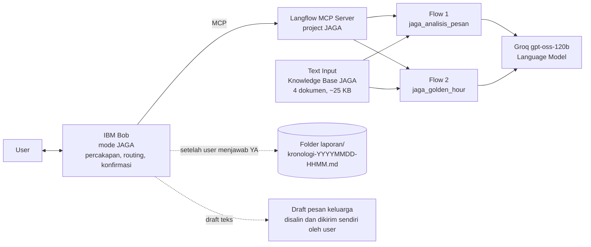

# JAGA - Asisten Tanggap Darurat Penipuan Digital

Hacktiv8 x IBM SkillsBuild National Hackathon 2026 | Tema: Financial
Dibangun dengan Langflow (eksekusi workflow, LLM openai/gpt-oss-120b via Groq) dan IBM Bob (antarmuka percakapan).

## 1. Ringkasan

JAGA membantu masyarakat, terutama orang tua dan pengguna yang kurang melek digital, dalam dua momen:
1. Sebelum tertipu: mengecek apakah sebuah pesan, link, atau file berisiko penipuan
2. Sesudah tertipu: memandu langkah darurat di "golden hour" dan menyiapkan kronologi laporan dalam hitungan menit

JAGA tidak pernah mengirim apa pun sendiri (tidak ada email, WhatsApp, atau laporan otomatis). Semua yang keluar dari JAGA berupa draft yang disimpan atau disalin dan dikirim sendiri oleh user, setelah user setuju.

## 2. Masalah

- Sejak 22 November 2024 sampai 30 September 2026, Indonesia Anti-Scam Centre (IASC) menerima 702.342 laporan penipuan transaksi keuangan (Bisnis.com, 6 Oktober 2026)
- Total kerugian yang dilaporkan mencapai Rp9,1 triliun per 14 Januari 2026, sementara dana yang berhasil diblokir sekitar Rp436,88 miliar (Kontan, 22 Januari 2026)
- Sekitar 80% laporan baru disampaikan lebih dari 12 jam setelah kejadian, padahal dana penipuan bisa keluar dari rekening korban dalam kurang dari 1 jam (CNBC Indonesia, 21 Juni 2026)

Insight: celah terbesar ada di jeda antara kejadian dan tindakan. Korban panik, tidak tahu langkah pertama, dan tidak tahu harus melapor ke mana. Edukasi dan portal laporan yang ada mengandalkan korban yang tenang dan sudah tahu prosedurnya.

Problem statement:
Bagaimana cara kita membantu korban penipuan digital, terutama orang tua dan pengguna yang kurang melek digital, mengambil langkah penyelamatan dana dalam satu jam pertama, meskipun mereka panik dan tidak tahu harus melapor ke mana?

## 3. Solusi dan fitur

| Mode | Untuk siapa | Yang dilakukan |
|---|---|---|
| Mode Cek | Orang yang menerima pesan mencurigakan | Menilai risiko (TINGGI, SEDANG, RENDAH, TIDAK_PASTI), menunjukkan tanda bahaya, menjelaskan dengan bahasa sederhana, memberi saran tindakan dan sumber |
| Mode Golden Hour | Korban yang sudah transfer, instal APK, memberi OTP, atau akunnya diambil alih | Langkah darurat berurutan, kontak resmi bank dan OJK, draft kronologi laporan IASC, checklist bukti. Draft kronologi bisa disimpan Bob ke file `laporan/kronologi-<YYYYMMDD-HHMM>.md` setelah user menjawab setuju |
| Mode Penjaga Keluarga | Orang tua dan anak sebagai kontak darurat | Bob menyusun draft pesan WhatsApp atau SMS singkat untuk keluarga (tanpa data rekening). User yang menyalin dan mengirimnya sendiri |

## 4. Arsitektur



Di dalam tiap flow: Chat Input dan Text Input "Knowledge Base JAGA" masuk ke Prompt Template, lalu Language Model (Groq), lalu Chat Output. Knowledge base tidak memakai vector search. Keempat dokumen digabung dan disuntikkan langsung ke prompt (variabel {konteks}), karena ukurannya kecil. Jawaban selalu berpijak pada seluruh isi knowledge base dan tidak ada risiko retrieval mengambil potongan yang meleset.

Pembagian tanggung jawab (sesuai prinsip "logika workflow di Langflow, logika percakapan di Bob"):

| Lapisan | Tanggung jawab |
|---|---|
| IBM Bob (custom mode JAGA) | Memahami maksud user, memilih flow yang tepat, menjaga nada tenang di mode darurat, menolak menerima PIN/OTP, menyusun draft pesan keluarga, menyimpan kronologi ke file laporan/ hanya setelah user setuju, menjelaskan hasil |
| Langflow Flow 1 | Analisis pesan dengan grounding penuh ke knowledge base (modus penipuan), output JSON terstruktur |
| Langflow Flow 2 | Langkah darurat, kontak resmi, dan draft kronologi, dengan grounding penuh ke knowledge base |
| Text Input "Knowledge Base JAGA" | Menyimpan 4 dokumen knowledge base yang disuntikkan ke prompt kedua flow |
| Groq (openai/gpt-oss-120b) | Language Model di kedua flow lewat komponen Language Model Langflow |
| Penyimpanan dan pengiriman | Tidak ada flow yang mengirim apa pun. File kronologi hanya ditulis Bob setelah user setuju, pesan keluarga dikirim sendiri oleh user |

Integrasi: project Langflow JAGA diekspos sebagai MCP server, setiap flow menjadi tool (`jaga_analisis_pesan` dan `jaga_golden_hour`). Bob terhubung lewat `.bob/mcp.json` dan memakai custom mode JAGA (`.bob/custom_modes.yaml` dan `.bob/rules-jaga/`).

## 5. Struktur repository

```
jaga/
  README.md                         dokumentasi teknis ini
  knowledge_base/                   4 dokumen sumber, digabung ke Text Input "Knowledge Base JAGA"
  langflow_prompts/                 panduan build dan prompt tiap flow
  bob/.bob/                         custom mode, rules, contoh mcp.json untuk IBM Bob
  bob/SETUP_BOB_DAN_SMOKE_TEST.md   panduan integrasi dan uji end-to-end
  tests/test_cases.json             26 kasus uji berlabel
  tests/run_eval.py                 script evaluasi otomatis via Langflow API
  submission/                       jawaban form, BMC, kuesioner, naskah pitching
```

## 6. Cara menjalankan

1. Jalankan Langflow, buat project JAGA, dan bangun dua flow sesuai `langflow_prompts/00_panduan_build_langflow.md` (Chat Input + Text Input "Knowledge Base JAGA" ke Prompt Template ke Language Model Groq ke Chat Output). Simpan GOOGLE_API_KEY sebagai Global Variable
2. Tempel gabungan 4 file di `knowledge_base/` ke Text Input "Knowledge Base JAGA" di kedua flow
3. Aktifkan flow `jaga_analisis_pesan` dan `jaga_golden_hour` di tab MCP Server dan isi nama serta deskripsi tool
4. Salin folder `bob/.bob` ke workspace Bob, buat `.bob/mcp.json` dari konfigurasi di tab MCP Server Langflow (contoh: `mcp.json.example`)
5. Pilih mode JAGA di Bob dan uji 4 skenario di `bob/SETUP_BOB_DAN_SMOKE_TEST.md`
6. Jalankan `tests/run_eval.py` untuk evaluasi otomatis (butuh kuota API yang cukup untuk 26 kasus)

## 7. Pengujian

### 7.1 Uji awal manual (sudah dijalankan)

Enam kasus diuji langsung ke flow di Langflow (tiga untuk Flow 1, tiga untuk Flow 2). Semuanya lolos. Ini uji awal berskala kecil, bukan evaluasi statistik, jadi tidak ada angka persentase yang diklaim.

| Flow | Kasus | Yang diharapkan | Hasil |
|---|---|---|---|
| 1 | Pesan APK berkedok kurir paket | Risiko TINGGI | Lolos: TINGGI, JSON valid |
| 1 | Pesan normal dari ibu | Risiko RENDAH | Lolos: RENDAH, JSON valid |
| 1 | Transfer ke penjual Instagram | Risiko TINGGI dan perlu_golden_hour true | Lolos: TINGGI, perlu_golden_hour true |
| 2 | Sudah instal APK, mobile banking BRI | Skenario A, langkah pertama mode pesawat, kontak BRI | Lolos: Skenario A, mode pesawat, menyebut 14017 |
| 2 | Sudah transfer, BCA | Skenario B, kontak BCA dan IASC, kronologi memakai placeholder | Lolos: Skenario B, menyebut 1500888 dan iasc.ojk.go.id, [ISI SENDIRI] |
| 2 | Sudah memberi OTP, BNI | Skenario C, kontak BNI, tidak meminta OTP | Lolos: Skenario C, menyebut 1500046, tidak meminta OTP |

Pemeriksaan tambahan di ketiga kasus Flow 2: tidak ada nomor di luar knowledge base dan tidak ada janji dana pasti kembali.

Satu iterasi perbaikan prompt: pada uji pertama Flow 2, kronologi sempat mengarang tindakan korban dan ada nama layanan di luar knowledge base. Prompt direvisi satu kali (aturan kronologi diperketat, dilarang menyebut nama layanan atau nomor di luar knowledge base), lalu uji ulang lolos.

Catatan jujur: beberapa output kronologi masih menyisakan penanda template mentah seperti [tanggal] atau [kanal], yang dilengkapi user sendiri.

### 7.2 Evaluasi 26 kasus (dijalankan 11 Oktober 2026, model openai/gpt-oss-120b via Groq)

Test set `tests/test_cases.json`: 20 pesan berlabel untuk Flow 1 (12 penipuan dari 9 modus, 2 mencurigakan ringan, 4 normal termasuk bahasa Jawa, 1 tidak jelas, 1 sudah jadi korban) dan 6 skenario darurat untuk Flow 2. Semua 26 kasus dijalankan ke flow di Langflow dan semuanya mengembalikan jawaban (0 error). Metrik dihitung mengikuti definisi di `tests/run_eval.py`.

Flow 1 - jaga_analisis_pesan (n = 20)

| Metrik | Hasil |
|---|---|
| Akurasi label risiko | 85% (17/20) |
| Pesan penipuan jelas (12 modus + 1 korban) terdeteksi TINGGI/SEDANG | 100% (13/13) |
| Recall termasuk 2 pesan "mencurigakan ringan" | 87% (13/15) |
| False-safe (pesan berlabel penipuan/mencurigakan dinilai RENDAH) | 13% (2/15), keduanya kategori mencurigakan ringan |
| False alarm pada pesan normal (dinilai TINGGI) | 0% (0/4), termasuk pesan bahasa Jawa |
| Pesan tidak jelas dinilai TIDAK_PASTI | 1/1 |
| Output JSON valid | 100% (20/20) |
| Deteksi kebutuhan mode darurat benar | 100% (20/20) |
| Disclaimer selalu ada | 100% (20/20) |

Kasus yang salah:
- A12 (belanja di luar marketplace): diharapkan TINGGI, keluar SEDANG. Tetap terdeteksi berisiko dan saran tindakannya benar.
- A13 (telemarketing asuransi) dan A14 (orang asing mengaku kenal): diharapkan SEDANG, keluar RENDAH. Model menilai keduanya belum mengandung permintaan data atau uang. Ini titik perbaikan berikutnya: pesan dari orang tak dikenal tanpa permintaan apa pun sebaiknya tetap diberi peringatan ringan.

Flow 2 - jaga_golden_hour (n = 6)

| Metrik | Hasil |
|---|---|
| Skenario utama tepat | 83% (5/6); G04 (WhatsApp diambil alih) diberi label gabungan C dan D, langkahnya tetap sesuai Skenario D |
| Kontak resmi yang diharapkan muncul | 100% (6/6) |
| Nomor telepon di luar knowledge base | 0 dari 6 output |
| Meminta PIN/OTP/password | 0 dari 6 output |
| Menjanjikan dana pasti kembali | 0 dari 6 output |
| Kronologi memakai placeholder privasi ([ISI SENDIRI]/[BELUM DIKETAHUI]) | 83% (5/6) |
| Bank di luar daftar (Bank Jago) | Tidak mengarang nomor, diarahkan ke nomor di balik kartu ATM |

Temuan untuk perbaikan:
- Di 3 dari 6 kronologi, model masih menuliskan tindakan yang belum dilakukan user (misalnya "saya telah menghubungi call center") walau jamnya dikosongkan.
- Di 2 dari 6 checklist bukti, model menyarankan menyimpan tangkapan layar SMS berisi OTP. Aturan prompt sudah melarang ini, jadi perlu diperketat.

Latensi: 3 sampai 6 detik per kasus saat tidak ada antrean. Saat 26 kasus dijalankan beruntun, sebagian kasus menunggu 30 sampai 43 detik karena batas token per menit free tier Groq. Untuk demo satu percakapan, respons tetap beberapa detik.

Catatan model: evaluasi dan demo memakai model yang sama (openai/gpt-oss-120b di Groq). Uji awal 7.1 dilakukan saat flow masih memakai Gemini.

## 8. Responsible AI

| Prinsip | Implementasi |
|---|---|
| Transparansi | Setiap penilaian menyebut sumber dari knowledge base dan ditutup disclaimer bahwa AI bisa keliru |
| Ketidakpastian | Label TIDAK_PASTI untuk pesan yang tidak cukup informasi; tidak pernah menyatakan "100% aman" |
| Human oversight | JAGA tidak pernah mengirim pesan atau laporan sendiri. File kronologi hanya ditulis setelah user menjawab YA, lalu Bob masih meminta approval tulis file (dua lapis). Pesan untuk keluarga hanya berupa draft yang dikirim sendiri oleh user |
| Privasi | Tidak pernah meminta atau meneruskan PIN, OTP, password, CVV, nomor rekening korban; PIN, OTP, dan nomor rekening korban tidak pernah ditulis ke file; data pribadi di kronologi memakai placeholder [ISI SENDIRI]; draft pesan keluarga tanpa data rekening; API key disimpan sebagai Global Variable Langflow |
| Akurasi informasi | Hanya menyebut nomor kontak yang ada di knowledge base; selalu mengingatkan verifikasi ke nomor di balik kartu ATM |
| Fairness | Penilaian berdasarkan isi pesan, bukan gaya bahasa atau bahasa daerah; test set memuat pesan normal berbahasa Jawa untuk menguji false alarm |
| Least privilege | Mode JAGA di Bob hanya punya tool group MCP dan hak edit yang dibatasi ke file `laporan/*.md` (fileRegex), tanpa terminal. Hanya jaga_analisis_pesan, jaga_golden_hour, dan ping yang masuk alwaysAllow |
| Tidak menggantikan otoritas | JAGA menyiapkan, korban yang menghubungi bank dan mengirim laporan ke IASC. Selalu ada jalur ke manusia: OJK 157 |

## 9. Keterbatasan

- Knowledge base statis dan disuntikkan utuh ke prompt; cocok untuk ukuran sekarang (~25 KB) tapi perlu retrieval kalau membesar. Modus baru belum otomatis masuk
- JAGA belum bisa mengirim pesan atau laporan sendiri. User harus menyalin draft pesan keluarga dan mengirim laporan ke IASC sendiri
- Belum membaca screenshot atau file langsung (input berupa teks)
- Tidak bisa memverifikasi apakah nomor rekening atau nomor HP pelaku sudah pernah dilaporkan
- Daftar call center terbatas pada beberapa bank besar
- Evaluasi baru berupa 6 uji awal manual; evaluasi otomatis 26 kasus belum dijalankan penuh karena batas kuota API

## 10. Roadmap

| Tahap | Rencana |
|---|---|
| Bulan 1-2 | Input screenshot dengan model vision, pembaruan knowledge base mingguan dari rilis resmi OJK dan bank, retrieval vector (Astra DB) saat knowledge base membesar melebihi muatan prompt |
| Bulan 3-4 | Kanal WhatsApp, integrasi kirim email atau WhatsApp resmi untuk Penjaga Keluarga (tetap dengan persetujuan user), uji coba dengan komunitas lansia dan kampus, perluasan daftar kontak resmi |
| Bulan 5-6 | Pilot B2B dengan satu bank daerah atau e-wallet sebagai fitur anti-scam di aplikasi mereka |
| Lanjut | Integrasi API pelaporan resmi jika tersedia, dukungan bahasa daerah |

## 11. Sumber data

- Bisnis.com, "OJK Terima 35.438 Pengaduan Entitas Keuangan Ilegal hingga September", 6 Oktober 2026
- Kontan, "Hingga 14 Januari 2026, Kerugian Masyarakat Akibat Penipuan (Scam) Rp 9,1 Triliun", 22 Januari 2026
- CNBC Indonesia, laporan tantangan penanganan scam IASC, 21 Juni 2026
- Siaran Pers OJK SP 09/GKPB/OJK/I/2026 tentang kerja sama OJK dan Bareskrim Polri untuk IASC
- Edukasi modus APK dari Bank Indonesia dan DJPb Kemenkeu
